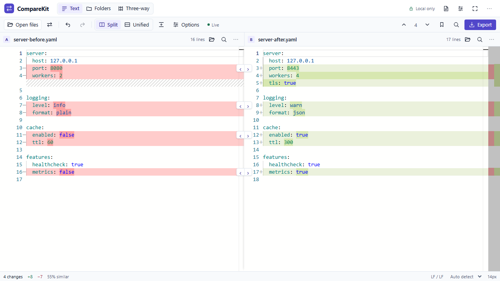
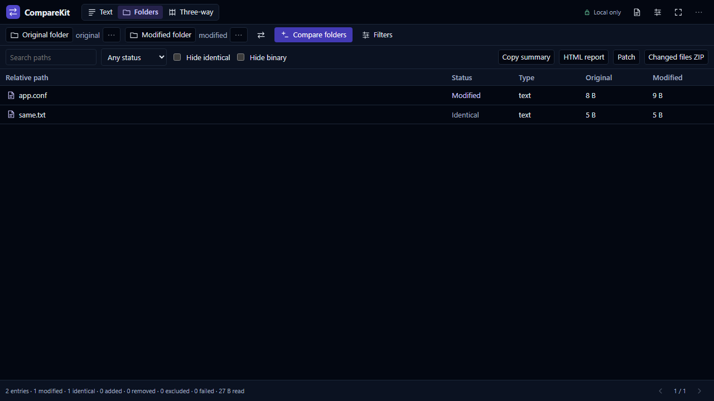

# CompareKit

CompareKit is an open-source tool for comparing and merging text, files, and folders. Paste text, open local files, or pick two folders to compare. Your inputs stay on your device, and the app runs without an account.

[Open CompareKit](https://astro1247.github.io/CompareKit/) · [Self-host CompareKit](docs/deployment.md) · [Report an issue](https://github.com/Astro1247/CompareKit/issues)

Select **Try sample** in the workspace to see a text comparison and its merge controls.



## Start with Docker Compose

With Docker Engine and the Compose plugin installed, clone the repository and start CompareKit.

```sh
git clone https://github.com/Astro1247/CompareKit.git
cd CompareKit
docker compose up --build -d
```

Open [CompareKit on localhost](http://localhost:8080). The standard deployment listens on all interfaces. Set `COMPAREKIT_BIND=127.0.0.1` in a local `.env` file before starting if you want access from this machine only. [Compose and network options](docs/deployment.md#standard-compose)

## Run standalone

You can run the compiled app and its bundled server with Node.js 22.12 or later. The **comparekit-standalone** artifact from GitHub CI includes both and requires no npm install. [Download and run a CI build](docs/deployment.md#use-a-prebuilt-ci-artifact)

To build from source, run from the project checkout.

```sh
npm ci
npm run build
npm start
```

Open [CompareKit on localhost](http://127.0.0.1:8080). The loopback server works with the internet disconnected after the build. You can also serve `dist/` from an existing HTTP or HTTPS server. [Standalone and static hosting](docs/deployment.md#standalone-and-static-hosting)

## Use the workspace

- **Text** has two editable Monaco panes, split and unified views, keyboard navigation, bookmarks, search and replace, and live or manual comparison. Indentation-only and trailing whitespace edits have a subtle inline highlight and a separate count. Select either arrow in the center gutter to apply a change. The bookmark menu includes bulk merge and folding controls.
- **Folders** compares files by SHA-256. Pick both directories, optionally set scan filters, and select a changed text file to open it in the editor. **Stage modified** includes the edited result in folder patch and ZIP exports. Folder selections remain read-only.
- **Three-way** compares two edited files, A and B, against the file they both started from. Compatible changes go into a separate merge result. Use the buttons beside changed lines to resolve conflicts. All four panes keep corresponding lines in view while you scroll. Turn off **Sync scrolling** in the toolbar to scroll independently. **Compare two files** switches to the Text workspace, where you can merge changes directly into either input. [Three-way workspace](docs/screenshots/three-way.png)
- **Options** supports whitespace, case, blank-line, line-ending, Unicode, JSON equivalence and regex rules. Merges use source ranges. Patches and reports retain original differences even when a workspace ignores them.
- **Export** offers unified diffs, Git-compatible patches, standalone HTML reports, JSON sessions and compressed share links. Share links carry the original text in the URL fragment. Treat a share link as sensitive as the files it contains.
- **Sessions** holds open comparisons in memory. Enable explicit saves in **Settings → Privacy** to save selected sessions in the current browser. Theme and editor preferences have a separate storage setting.



## Shortcuts

| Action | Shortcut |
| --- | --- |
| Compare, open files, export | Ctrl/⌘+Enter, Ctrl/⌘+O, Ctrl/⌘+S |
| Undo and redo | Ctrl/⌘+Z, Ctrl/⌘+Shift+Z or Ctrl+Y |
| Next and previous change | F7, Shift+F7 |
| Apply to original or modified | Alt+Left, Alt+Right |
| Bookmark and navigate bookmarks | Ctrl/⌘+B, Alt+Shift+Left/Right |
| Search both inputs | Ctrl/⌘+Shift+F |
| Swap, toggle unified view, toggle folding | Ctrl/⌘+Shift+X / U / H |
| Fullscreen | Alt+Shift+F |
| Copy diff or download a patch | Ctrl/⌘+Shift+C / P |
| Settings or shortcut search | Ctrl/⌘+Comma / Slash |

Current Chromium and Firefox are covered by browser tests. Chrome, Edge and Firefox support folder inputs. An additional Chromium directory picker on secure origins includes empty directories. Popovers and merge controls support keyboard navigation.

## Project documentation

- [Deployment and HTTPS](docs/deployment.md)
- [Architecture, session format and limits](docs/architecture.md)
- [Running tests and benchmarks](docs/verification.md)
- [Upstream projects and feature comparison](FEATURE_PARITY.md)
- [Security and privacy](SECURITY.md)
- [Contributing](CONTRIBUTING.md)
- [MIT license](LICENSE) and [third-party notices](THIRD_PARTY_NOTICES.md)

